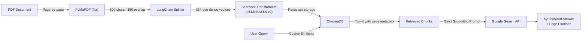

# DocuRAG 📄🔍

> **High-Precision Document Retrieval-Augmented Generation (RAG) System**  
> Ingest PDFs, extract text page-by-page with PyMuPDF, generate dense semantic embeddings with Sentence Transformers, index into ChromaDB, and synthesize grounded answers with page-level citations using Google Gemini API.

---

## 🌟 Architecture & Data Flow

The system implements an end-to-end RAG lifecycle:

```
PDF Document
     ↓
Text Extraction (PyMuPDF / fitz)
     ↓
Recursive Chunking (LangChain)
     ↓
Dense Embeddings (Sentence Transformers all-MiniLM-L6-v2)
     ↓
Vector Database (ChromaDB persistent)
     ↓
Similarity Search (Cosine Distance / Top-K)
     ↓
LLM Synthesis (Google Gemini API: gemini-2.0-flash)
     ↓
Grounded Answer + Page-Level Source Citations
```



---

## 🛠️ Tech Stack

| Layer | Technology | Details |
| :--- | :--- | :--- |
| **Backend Framework** | **FastAPI** | Asynchronous Python 3.12 REST API |
| **PDF Extraction** | **PyMuPDF (`fitz`)** | Fast, lossless page-by-page text extraction preserving page numbers |
| **Chunking Engine** | **LangChain** | `RecursiveCharacterTextSplitter` with page-aware metadata |
| **Dense Embeddings** | **Sentence Transformers** | Local `all-MiniLM-L6-v2` (384-dimensional dense vectors) |
| **Vector Database** | **ChromaDB** | Persistent local vector store with cosine distance indexing |
| **LLM Provider** | **Google Gemini API** | `gemini-2.0-flash`, `gemini-1.5-flash`, or `gemini-1.5-pro` |
| **Frontend UI** | **Next.js & TypeScript** | App Router, responsive glassmorphism aesthetic, dark mode |

---

## ✨ Features

- **Interactive 7-Stage Pipeline Visualizer**: Real-time visual tracking of each step from raw PDF to Gemini generation.
- **Page-Aware Text Chunking**: Every chunk retains its originating page number, index, and character count.
- **ChromaDB Chunk Inspector**: Built-in modal viewer to search and inspect every chunk indexed in the vector store.
- **Strictly Grounded Answers**: System prompt instructs Gemini to cite specific page numbers (e.g. `[Page 2]`) and avoid hallucinations.
- **Expandable Source Citations**: Each assistant response includes interactive cards with page numbers, relevance confidence scores, and passage snippets.
- **Dynamic API Settings**: Switch Gemini models (`gemini-2.0-flash`, `gemini-1.5-flash`, `gemini-1.5-pro`) and tune retrieval Top-K directly from the UI.

---

## 🚀 Getting Started

### Prerequisites
- **Python 3.10+** (Python 3.12 recommended)
- **Node.js 18+** and **npm**
- **Google Gemini API Key** (Get a free key from [Google AI Studio](https://aistudio.google.com/app/apikey))

---

### 1. Backend Setup

```bash
# Navigate to backend directory
cd backend

# Create a virtual environment
python -m venv venv

# Activate virtual environment
# Windows (PowerShell):
.\venv\Scripts\Activate.ps1
# Linux/macOS:
source venv/bin/activate

# Install dependencies
pip install -r requirements.txt

# (Optional) Copy environment template and configure Gemini API key
cp .env.example .env
# Edit .env and set GEMINI_API_KEY=your_key_here

# Start FastAPI server
uvicorn app.main:app --host 127.0.0.1 --port 8000 --reload
```

* Backend API will be live at: `http://127.0.0.1:8000`
* Interactive API Documentation (Swagger): `http://127.0.0.1:8000/docs`

---

### 2. Frontend Setup

```bash
# Navigate to frontend directory
cd frontend

# Install dependencies
npm install

# Start Next.js development server
npm run dev
```

* Frontend UI will be live at: `http://localhost:3000`

---

## 📖 Usage Guide

1. Open **`http://localhost:3000`** in your browser.
2. Click **API Settings** in the top right header to paste your Gemini API key (if not already set in `.env`).
3. Drag and drop any PDF document into the upload zone.
4. Watch the pipeline visualizer process your document through PyMuPDF, LangChain, Sentence Transformers, and ChromaDB.
5. Click **Inspect Chunks** to explore the indexed passages and their page numbers.
6. Ask any question in the chat and receive grounded answers with exact source citations!

---

## 📂 Project Structure

```
DocuRAG/
├── backend/
│   ├── app/
│   │   ├── models/
│   │   │   └── schemas.py             # Pydantic request/response models
│   │   ├── services/
│   │   │   ├── pdf_service.py         # PyMuPDF text extraction
│   │   │   ├── chunking_service.py    # LangChain text splitter
│   │   │   ├── embedding_service.py   # Sentence Transformers embeddings
│   │   │   ├── vector_store.py        # ChromaDB vector store operations
│   │   │   └── rag_service.py         # Gemini API generation & citations
│   │   ├── config.py                  # Pydantic settings configuration
│   │   └── main.py                    # FastAPI endpoints & CORS
│   ├── requirements.txt               # Pinned Python dependencies
│   └── .env.example                   # Environment variable template
│
├── frontend/
│   ├── src/
│   │   ├── app/
│   │   │   ├── globals.css            # Dark glassmorphic design system
│   │   │   ├── layout.tsx             # Root layout & SEO metadata
│   │   │   └── page.tsx               # Main dashboard component
│   │   ├── components/
│   │   │   ├── Header.tsx             # Navigation & model status
│   │   │   ├── PipelineVisualizer.tsx # 7-stage RAG lifecycle visualizer
│   │   │   ├── DocumentUpload.tsx     # PDF drag-and-drop & metadata card
│   │   │   ├── ChunkInspector.tsx     # ChromaDB vector chunk modal
│   │   │   ├── ChatInterface.tsx      # Grounded Q&A with source cards
│   │   │   └── SettingsModal.tsx      # Gemini API key & model settings
│   │   ├── services/
│   │   │   └── api.ts                 # Backend API client
│   │   └── types/
│   │       └── index.ts               # TypeScript interfaces
│   ├── package.json
│   └── tsconfig.json
│
├── .gitignore                         # Excludes venv, node_modules, data, secrets
└── README.md
```

---

## 📄 License

This project is licensed under the MIT License. All local components (PyMuPDF, LangChain, Sentence Transformers, ChromaDB, Next.js) are 100% open-source and free to use.
